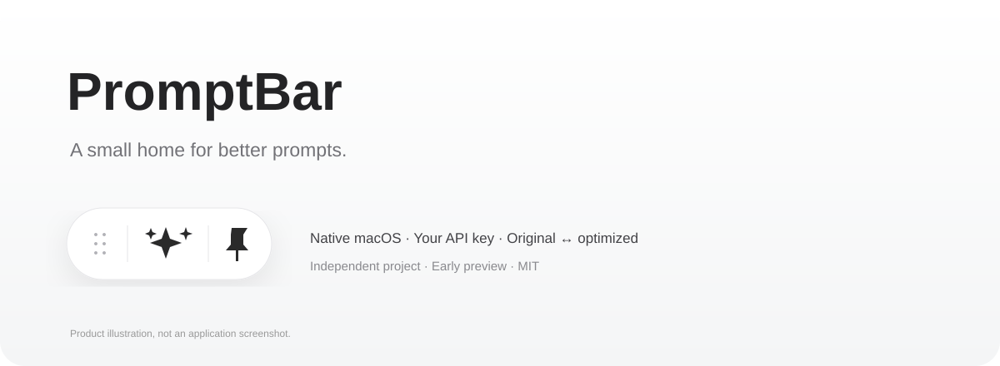

<p align="center"></p>

# PromptBar

**A tiny floating prompt editor for macOS. Bring your own API key.**

[中文](README.zh-CN.md) · [Download preview](https://github.com/gufanyuanying031/promptbar/releases) · [User guide](docs/USER_GUIDE.md) · [Report a bug](https://github.com/gufanyuanying031/promptbar/issues/new)

PromptBar keeps prompt editing within reach while you work in Codex, ChatGPT, or another app. Copy a draft, refine it using your configured model, switch between the original and optimized versions, then paste it back.

It uses the clipboard. It does **not** inject buttons into other apps or automatically submit messages.

> **Early preview · Apple Silicon · macOS 14+**
> **English and Simplified Chinese UI** are available in Settings. Language switches immediately and is remembered; the initial choice follows your system. Prompt language is preserved.
>
> Downloads are ad-hoc signed, **not Developer ID signed or notarized**. macOS may block a downloaded build. You can review the source and build locally. This is not yet a polished, universally tested production release.

## Why a floating bar?

- **Keep the capsule in place.** A separate editor opens above or below it; fitting the editor to the display does not resize the capsule.
- **Keep the original.** Optimize, restore the original, or switch back without another request.
- **Choose the rewriting style.** Balanced, concise, structured, coding, research, natural writing, or your own rules. Changing the style re-optimizes the original snapshot when available.
- **Use your own provider.** OpenAI-compatible, Anthropic Messages, and Gemini generateContent adapters. Keys are stored in macOS Keychain.
- **Stay compact.** A white glass capsule, drag handle, independent always-on-top toggle, long-text editor, press feedback, progress ring, and animated opening/closing.
- **Reuse prompts.** Local history, pinned entries in the library, search, and JSON import/export.

## Quick start

1. Download `PromptBar-0.15.0-mac-arm64.zip` from [Releases](https://github.com/gufanyuanying031/promptbar/releases), extract it, and place `PromptBar.app` in Applications. Quit older copies first.
2. Launch the app. Right-click the capsule or menu-bar icon → **设置…** (Settings). Choose English or 简体中文 using the language picker.
3. Select the provider, verify its HTTPS base URL and exact model ID, enter an API key, then click **保存** (Save).
4. Hover over the middle sparkles or click them to open the editor. Paste your prompt and click the **rightmost sparkles button**.
5. Click Copy, then paste the result into your original app.

Requests go to the endpoint you configure and may incur provider fees. Changing styles on nonempty input also sends a request. Connection testing sends a small request.

## Providers

| Preset | Protocol | Model setup |
| --- | --- | --- |
| DeepSeek | OpenAI-compatible | `deepseek-flash` default; `deepseek-v4-pro` shortcut |
| OpenAI, SiliconFlow, Alibaba Cloud | OpenAI-compatible | Enter an available model ID |
| Anthropic | Messages | Enter an available model ID |
| Google Gemini | generateContent | Enter a model ID without `models/` |
| Custom | One of the three adapters | Enter endpoint, model, and key |

Preset availability is not a guarantee that a model is enabled on your account. DeepSeek IDs were checked against its [official integration docs](https://api-docs.deepseek.com/quick_start/agent_integrations/) on November 1, 2026. Provider details can change.

## Build and check

Requires macOS, Apple Silicon, and Xcode Command Line Tools with a compatible Swift/macOS SDK. No third-party package dependencies or Xcode project are required.

```sh
git clone https://github.com/gufanyuanying031/promptbar.git
cd promptbar
zsh Source/build.sh
zsh scripts/test.sh
```

The build produces `PromptBar.app` with an ad-hoc signature. The release is arm64 only; the source has not been validated on Intel Macs or every supported macOS version. Local development was tested with Swift 6.4.2 using Swift 5 language mode on macOS 27.2, targeting macOS 14.

## Privacy and limitations

Keys use Keychain service `app.promptbar.native.v1`. Preferences and prompt history live in `~/Library/Application Support/PromptBar/`; history is **unencrypted local JSON**. Exported entries contain prompt text but no keys. No analytics, custom relay, or cloud history sync is implemented. Prompts and authorization headers are sent to your configured provider.

Current limitations: no automatic updates, Developer ID notarization, direct composer integration, system-wide selected-text replacement, streaming output, multiple custom provider accounts, or automatic clipboard return. Unsaved drafts are session-only. Clipboard paste replaces the current draft without confirmation. Prompt rewriting can change intent; review the result.

Core and state checks cover request formats, parsing, cancellation/snapshots, storage, style edge cases, and panel geometry. They do not establish model quality or complete UI reliability. Live API integration and a broad hardware/OS matrix have not been verified. See [validation](docs/VALIDATION.md).

## Roadmap & feedback

More reliable interaction testing, a reproducible signed release pipeline, and broader OS coverage are priorities. Please share reproducible bugs through Issues; include the release version and steps, and **remove keys and private prompt text**.

If this small workflow helps you, a star or a link shared with a friend is appreciated.

## Credits and license

Independent SwiftUI/AppKit implementation, inspired by the prompt enhancement interaction in WorkBuddy and the feature organization of [Prompt Optimizer](https://github.com/linshenkx/prompt-optimizer). No code or prompt templates from that AGPL project were copied. This is not affiliated with WorkBuddy, Tencent, OpenAI, or Apple.

[MIT](LICENSE) · © 2026 jlwang and PromptBar contributors.
