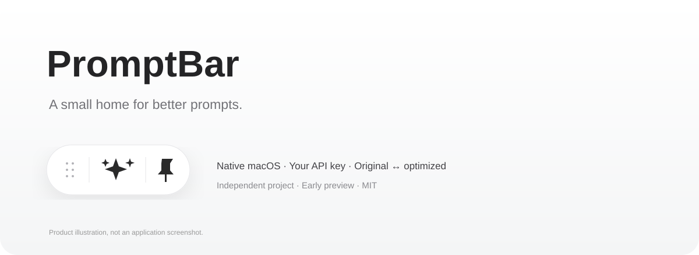

# PromptBar

**随手优化提示词的 macOS 悬浮栏，自带 API Key，自由选择模型。**

[English](README.md) · [下载预览版](https://github.com/gufanyuanying031/promptbar/releases) · [中文使用指南](docs/使用指南.md)



在 Codex 或其他应用中写下想法，复制到 PromptBar 优化，再粘贴回去。胶囊固定在你放置的位置，编辑面板独立展开，不向其他应用注入按钮，不自动发送消息。

## 功能

- 白色玻璃胶囊：六点拖动、三颗星进入编辑、图钉保持窗口最前。
- 中英文界面实时切换，默认随系统语言，独立于提示词的语言。
- 优化、还原原文、切回优化稿；切换风格自动根据原文重新优化。
- 七种风格与自定义规则；OpenAI 兼容、Anthropic、Gemini 三种 API 协议。
- Key 存入 macOS 钥匙串；本地历史、条目库、JSON 导入导出。
- 长文编辑、直接粘贴、一键清空、复制确认、悬停浮签、按压反馈和双向开合动画。

## 安装与开始

适用于 Apple Silicon，构建目标 macOS 14+。从 Release 下载 ZIP，解压后将 App 移入“应用程序”。先退出旧副本。

这是 **early preview**，仅 ad-hoc 签名，**没有 Developer ID 签名或 Apple 公证**，下载后可能被 macOS 拦截；也可审查源码后本地构建。本次开发环境为 macOS 27.2 / Swift 6.4.2，未验证所有系统版本。

右键胶囊 → 设置 → 选择界面语言 → 配置厂商、模型 ID 与 Key → 保存。把提示词粘贴到展开栏，点击最右侧星星优化，再复制回原应用。

请求直接发送到你配置的 API 地址，可能产生费用；非空输入切换风格也会产生请求。不会使用 WorkBuddy 的账号、提示词或私有 API。

## 开发

```sh
git clone https://github.com/gufanyuanying031/promptbar.git
cd promptbar
zsh Source/build.sh
zsh scripts/test.sh
```

原生 SwiftUI + AppKit，无第三方包依赖，无 Electron 运行时。更多限制与验证范围见 [英文 README](README.md) 和 [验证说明](docs/VALIDATION.md)。

历史以未加密的本地 JSON 保存于 `~/Library/Application Support/PromptBar/`；Key 在系统钥匙串。退出时未收藏的会话草稿不会自动保存。优化可能改变含义，请检查后使用。

## 致谢与许可证

独立实现，交互灵感来自 WorkBuddy 提示词增强与 [Prompt Optimizer](https://github.com/linshenkx/prompt-optimizer) 的功能组织，未复制其 AGPL 源码或模板。与腾讯、OpenAI、Apple 无隶属关系。

[MIT](LICENSE)。欢迎提交可复现问题；请不要上传 Key 或私人提示词。觉得好用的话，欢迎 Star 和分享。
